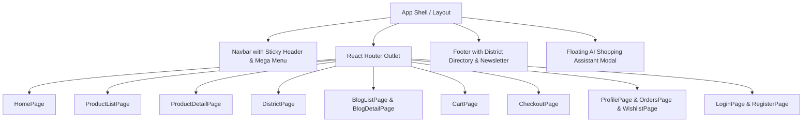
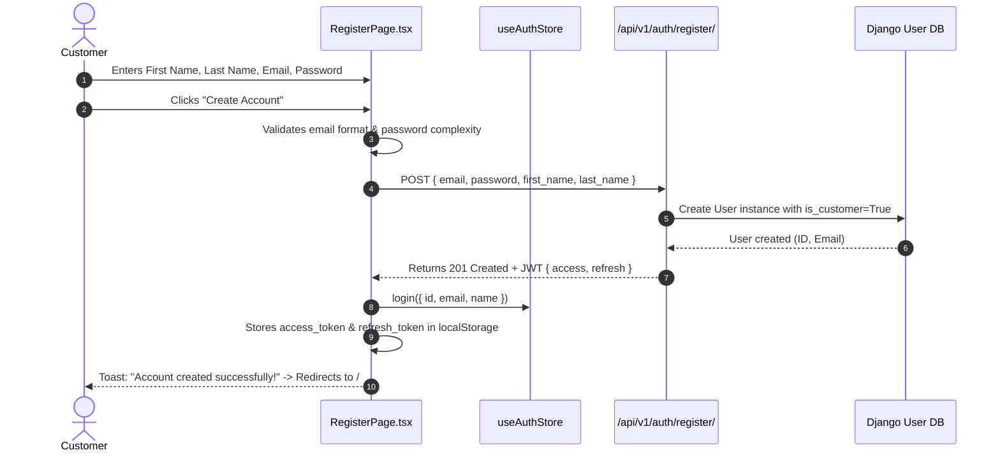
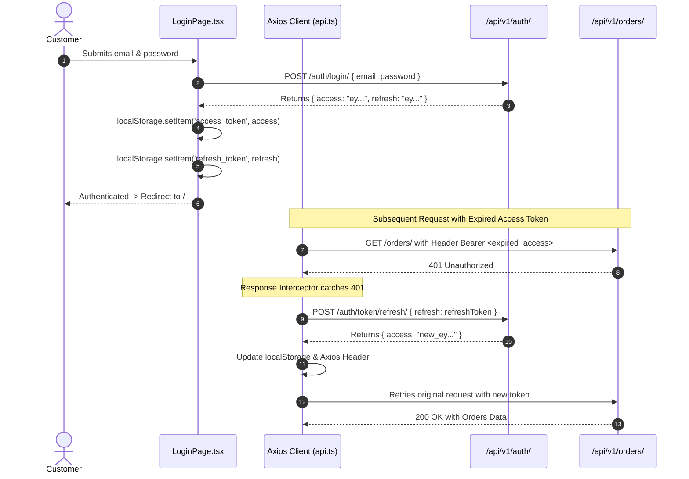
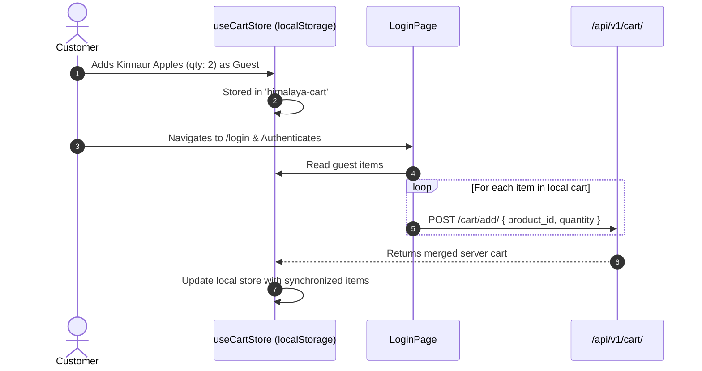
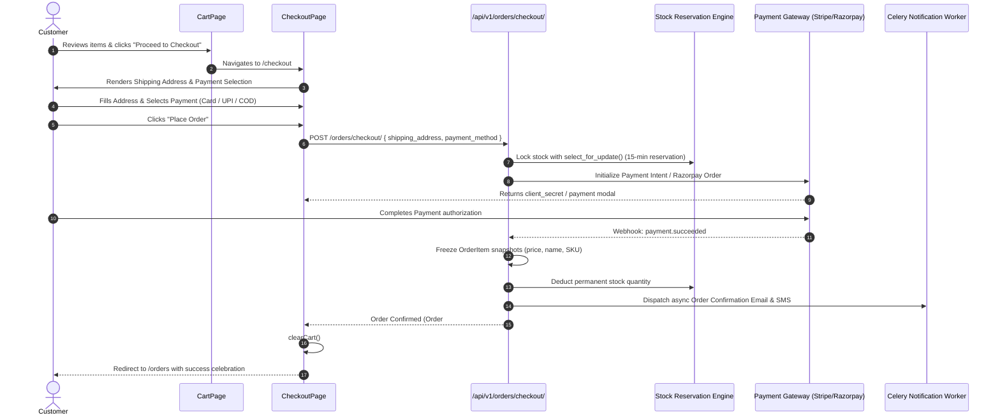

# Himalayan Fresh - UI/UX Design System, Feature Specifications & User Flows (`UI_UX_STYLE_GUIDE_AND_USER_FLOWS.md`)

> **Master Redesign Reference**: This document provides an exhaustive breakdown of the current UI/UX architecture, design tokens, page-by-page feature implementations, state handling, authentication workflows, checkout lifecycles, and identified design bottlenecks. Use this guide to systematically redesign and elevate the frontend experience while preserving seamless integration with the Django REST backend.

---

## 1. Executive Summary & Design Vision

### 1.1 Brand Identity & Concept
- **Brand**: Himalayan Fresh / Himachal Apples (EcomHub)
- **Concept**: Premium direct-to-consumer farm-to-table organic produce sourced directly from Himachal Pradesh's highest valleys (Kinnaur, Shimla, Kullu, Kangra, Lahaul & Spiti).
- **Aesthetic Benchmark**: Inspired by high-end artisanal organic brands (such as *Amber Tale Farms*): clean, nature-first, earthy, editorial, trustworthy, and luxury-organic.
- **Redesign Target**:
  1. Eliminate visual clashing (inconsistent background whites/creams and mismatched Tailwind color classes).
  2. Normalize spacing, remove awkward empty vertical gaps, and perfect mobile responsive padding.
  3. Introduce high-performance Three.js / React Three Fiber interactive 3D elements (Himachal apple orchard / 3D mountain terrain).
  4. Transition every user touchpoint from static mock data to the fully implemented Django REST Framework backend.

---

## 2. Current Style System & UI Design Tokens

### 2.1 Color Tokens & Palette

The platform currently possesses two color token sets: the defined system in `src/theme/index.ts` / `tailwind.config.js`, and ad-hoc Tailwind color names (`pine-*`, `charcoal-*`, `cream-*`) used throughout older JSX templates. 

#### Canonical Design System Tokens (`src/theme/index.ts`):
| Token Category | Token Name | Hex Code | Purpose & Application |
|---|---|---|---|
| **Primary (Forest Green)** | `primary.DEFAULT / main` | `#2d5a3d` | Brand identity, primary CTAs, active states, key icons |
| | `primary.light` | `#3d7a52` | Button hover states, secondary highlights |
| | `primary.dark` | `#1a3d28` | Header accents, high-contrast dark badges, text accents |
| | `primary.accent` | `#4a9063` | Borders, subtle focus rings |
| **Secondary (Earth Brown)** | `secondary.DEFAULT / main` | `#8b5a2b` | Terroir tags, wood/soil accents, organic badges |
| | `secondary.light` | `#a67c52` | Warm secondary borders and badges |
| | `secondary.dark` | `#5d3d1f` | Deep earth typography |
| | `secondary.accent` | `#cd7d54` | Warm terracotta highlights |
| **Accent (Golden Amber)** | `accent.DEFAULT / main` | `#d4a84b` | Discount badges, star ratings, seasonal ribbons |
| | `accent.light` | `#e8c97a` | Soft golden backgrounds |
| | `accent.dark` | `#b8860b` | Star borders, high-contrast badges |
| | `accent.yellow` | `#e89c14` | High-visibility flash badges ("Farm Fresh Daily") |
| **Backgrounds** | `background.primary` | `#ffffff` | Pure white card surfaces and clean page sections |
| | `background.secondary` | `#fdfcfa` | Warm alabaster / cream for alternating sections |
| | `background.tertiary` | `#f8f6f2` | Soft mountain mist parchment for inputs and tables |
| | `background.dark` | `#1a1a1a` | Dark charcoal for District and Footer showcases |
| **Text** | `text.primary` | `#1a1a1a` | High-legibility charcoal for headers and titles |
| | `text.secondary` | `#4a4a4a` | Subheadings, descriptions, and labels |
| | `text.tertiary` | `#6b6b6b` | Microcopy, dates, and secondary specifications |
| | `text.light` | `#9ca3af` | Placeholder text, struck-through original prices |
| **Status** | `status.success` | `#059669` | Order confirmed, stock available, free shipping |
| | `status.warning` | `#d97706` | Low stock alert, payment pending |
| | `status.error` | `#dc2626` | Form errors, payment failed, order cancelled |

> [!WARNING]
> **Identified Inconsistency**: Multiple components currently use deprecated ad-hoc classes such as `bg-cream-50`, `text-pine-700`, `text-charcoal-900`, `bg-pine-100`. The redesign must standardize all components to use the semantic tokens: `bg-background-secondary`, `text-primary`, `text-text-primary`, and `bg-primary/10`.

---

### 2.2 Typography System

The typography marries editorial luxury with high readability:
- **Headings Font**: `'Playfair Display', Georgia, serif`
  - Used for: Brand logo wordmark, $H1$–$H4$ headlines, section titles, card headers, prices.
  - Weights: `600` (SemiBold), `700` (Bold).
- **Body & Interface Font**: `'Inter', system-ui, -apple-system, sans-serif`
  - Used for: Navigation links, body copy, product specs, button labels, form inputs, metadata.
  - Weights: `400` (Regular), `500` (Medium), `600` (SemiBold), `700` (Bold).

#### Typography Scale:
| Level | Font Family | Size (Desktop / Mobile) | Weight | Line Height |
|---|---|---|---|---|
| **Display / Hero H1** | Playfair Display | `4.5rem` (72px) / `2.5rem` (40px) | Bold (700) | `1.1` |
| **Section Title H2** | Playfair Display | `2.5rem` (40px) / `1.875rem` (30px) | Bold (700) | `1.2` |
| **Component Header H3** | Playfair Display | `1.5rem` (24px) / `1.25rem` (20px) | SemiBold (600) | `1.3` |
| **Card Title H4** | Playfair Display | `1.125rem` (18px) | SemiBold (600) | `1.4` |
| **Body Large** | Inter | `1.125rem` (18px) | Regular (400) | `1.6` |
| **Body Standard** | Inter | `1rem` (16px) | Regular (400) | `1.6` |
| **Labels & Buttons** | Inter | `0.875rem` (14px) – `1rem` (16px) | SemiBold (600) | `1.4` |
| **Captions & Microcopy** | Inter | `0.75rem` (12px) | Medium (500) | `1.4` |

---

### 2.3 Layout Grids & Spacing System
- **Maximum Container Width**: `max-w-container` = `1400px` (centered with `mx-auto px-4 sm:px-6 lg:px-8`).
- **Section Vertical Rhythm**:
  - Hero: `min-h-[85vh]` with `py-20` (80px).
  - Main Sections: `py-16` (64px) to `py-20` (80px).
  - Component Stacks: `gap-6` (24px), `gap-8` (32px), `gap-12` (48px).
- **Border Radius**:
  - Inputs & Small Buttons: `rounded-xl` (12px).
  - Product & Content Cards: `rounded-2xl` (16px).
  - Modals, Hero Cards & Drawers: `rounded-3xl` (24px).
  - Badges & Pills: `rounded-full` (9999px).
- **Elevation & Shadows**:
  - Subtle Card: `shadow-md` (`0 4px 6px -1px rgba(0,0,0,0.05)`).
  - Hover Card: `shadow-xl` / `shadow-2xl`.
  - Floating Panels: `shadow-premium` (`0 25px 50px -12px rgba(0, 0, 0, 0.15)`).

---

### 2.4 Component Library & CSS Classes (`src/index.css`)

```css
/* 1. Buttons */
.btn-primary   /* Forest green background (#2d5a3d), white text, rounded-xl, hover translateY(-2px) */
.btn-secondary /* Transparent background, 2px border (#2d5a3d), forest green text */
.btn-accent    /* Golden amber background (#d4a84b), white text */

/* 2. Inputs */
.input-field   /* 100% width, border (#e5e5e5), padding (1rem 1.25rem), focus: ring rgba(45, 90, 61, 0.1) */

/* 3. Cards */
.card          /* White bg, rounded-2xl, soft shadow, hover shadow transition */
.card-premium  /* White bg, rounded-3xl, overflow-hidden, 30px shadow, high-end feel */

/* 4. Badges */
.badge-primary /* Forest green 10% tint bg, solid green text, rounded-full */
.badge-accent  /* Golden amber 15% tint bg, solid amber text, rounded-full */
```

---

## 3. Page-by-Page Feature Inventory & Functionality



---

### 3.1 Header & Navigation (`src/components/layout/Navbar.tsx`)

#### Current Features:
- **Sticky Scroll Trigger**: Uses `window.scrollY > 20` to toggle background blur and drop shadow.
- **Brand Emblem**: Dual-tone monogram "HF" icon box + "Himalaya Fresh" serif typography.
- **Desktop Navigation Menu**:
  - Direct links: `Home`, `Shop`, `Blog`, `About`, `Contact`.
  - Mega-Dropdowns: `Categories` (dropdown list with images and counts) and `Districts` (dropdown with regional tags).
- **Action Icons**:
  - **Search Trigger**: Opens expandable search input overlay; redirects to `/products?search=<query>`.
  - **Wishlist Badge**: Dynamic badge linked to `useWishlistStore` item count.
  - **Cart Icon & Badge**: Dynamic count badge linked to `useCartStore` total quantity; clicking navigates to `/cart`.
  - **User Profile / Auth Link**: Renders avatar / name when logged in; renders generic User icon leading to `/login` when unauthenticated.
- **Mobile Drawer**: Hamburger menu button toggling full-height slide-over navigation with accordion sub-menus.

---

### 3.2 Homepage (`src/pages/home/HomePage.tsx`)

#### Current Features & Sections:
1. **Hero Showcase Section**:
   - Background image with dark gradient overlay (`bg-gradient-to-r from-black/80 via-black/60 to-black/40`).
   - "Farm Fresh Daily" animated badge with golden sparkle icon.
   - Dual-color headline: "Premium Apples" in white + "From The Himalayas" in forest green light.
   - Dual action CTAs: "Shop Collection" (`/products`) and "View Varieties" (`/products?category=apples`).
   - Trust highlights: Free delivery above Rs. 999, 100% Organic Certified.
   - Featured product card with floating "25% OFF" discount ribbon and "Premium Quality" seal.
   - Bottom curved SVG wave transition.
2. **"Our Quality Promise" Section**:
   - 4-column feature grid with hover icon transformations:
     * 100% Wax Free (Leaf icon)
     * Certified Organic (Shield icon)
     * Direct from Farms (Mountain icon)
     * Fast Delivery (Truck icon)
3. **"Best Selling Apples" Carousel / Grid**:
   - Displays featured produce with image zoom on hover.
   - Badges: `Premium`, `Seasonal`.
   - Origin tag (e.g. Kinnaur, Shimla).
   - Rating stars with review count.
   - Quick Add-to-Cart and Heart Wishlist toggle buttons.
4. **"Explore Categories" Grid**:
   - 6-column circular / square image cards for: Royal Apples, Organic Fruits, Dry Fruits & Nuts, Mountain Vegetables, Honey & Preserves, Herbal & Medicinal.
5. **"From All 12 Districts" Terroir Showcase**:
   - Dark theme container with scenic photography.
   - Grid cards for Kinnaur, Shimla, Kullu, Kangra, Lahaul & Spiti, etc.
   - Direct link to District profile and terroir stories.
6. **Customer Testimonials**:
   - Customer review cards with verified buyer photos, star ratings, and city origin (Mumbai, Delhi, Bangalore).
7. **Newsletter / Direct Farm Subscription CTA**:
   - Email input with instant confirmation toast.

---

### 3.3 Product Catalog & Filter Hub (`src/pages/products/ProductListPage.tsx`)

#### Current Features:
- **Layout Switcher**: Toggle button between 4-column Grid View and single-column List View.
- **Search & URL Parameter Sync**: Reads `?category=` and `?search=` from query parameters.
- **Interactive Filters**:
  - Category selector tabs/pills.
  - Price Range Slider (Rs. 0 to Rs. 2,000).
  - Sort Dropdown: `Featured`, `Price: Low to High`, `Price: High to Low`, `Customer Rating`.
- **Product Card Actions**:
  - Real-time Wishlist toggle (`useWishlistStore`).
  - Direct Add-to-Cart action (`useCartStore`).
  - Click-through to detailed slug page (`/products/:slug`).
- **Empty State**: Friendly illustration and "Reset Filters" action when 0 products match.

---

### 3.4 Product Detail Page (`src/pages/products/ProductDetailPage.tsx`)

#### Current Features:
- **Dynamic Breadcrumbs**: Home / Products / Category / Product Name.
- **Image Gallery**: Large hero product image + interactive thumbnail selector.
- **Product Meta**:
  - Name, category, origin district tag, weight (e.g. 1 kg, 500g).
  - Price display with crossed-out original price and calculated discount percentage.
  - Stock availability pill (`In Stock` / `Out of Stock`).
- **Cart & Quantity Controls**:
  - Stepper (`-` / `+`) input for line-item quantity.
  - "Add to Cart" button with instant feedback toast.
  - Wishlist heart icon button.
- **Detailed Specifications Tabs**:
  - **Description**: Full story of produce and harvesting.
  - **Nutrition Facts**: Calories, Protein, Carbohydrates, Dietary Fiber, Vitamin C.
  - **Farm & Terroir Details**: Farmer Name, Farm Location, Altitude (e.g. 2,750m), Farming Method (Biodynamic / Natural).
- **Customer Reviews & Ratings**:
  - Overall rating score out of 5 with star breakdown.
  - List of verified purchase reviews.
  - Review submission modal/form (Rating 1–5 stars + review comment).
- **Related Products Carousel**: 4 recommended items from the same category.

---

### 3.5 Districts & Terroir Guide (`src/pages/districts/DistrictPage.tsx`)

#### Current Features:
- **District Directory Index (`/districts`)**:
  - High-altitude scenic grid covering all producing regions of Himachal Pradesh.
  - Product count and blog story count badges for each district.
- **Individual District Profile (`/districts/:slug`)**:
  - Hero banner with altitude (meters above sea level), climate, and soil characteristics.
  - "Native Produce": Products harvested exclusively in this valley.
  - "Farming Heritage": Stories and traditional agrarian culture of the district.

---

### 3.6 Blogs & Editorial Magazine (`src/pages/blogs/`)

#### Current Features:
- **Blog Listing (`BlogListPage.tsx`)**:
  - Featured Editorial Hero post.
  - Category filter pills (Orchard Stories, Health & Nutrition, Recipes, Farming Guides).
  - Article cards with author avatar, read time (e.g. 5 min read), view count, and publication date.
- **Blog Detail (`BlogDetailPage.tsx`)**:
  - Hero image with author byline and published timestamp.
  - Formatted reading view with pull quotes and section headers.
  - Engagement bar: Like button with live counter, Share button, comment section.
  - "Related Articles" section at bottom.

---

### 3.7 Shopping Cart (`src/pages/cart/CartPage.tsx`)

#### Current Features:
- **Empty State**: Centered shopping basket illustration with "Continue Shopping" button when items array is empty.
- **Line Items List**:
  - Product thumbnail, title (linked to slug), and package weight.
  - Interactive quantity stepper (`-` and `+`) with auto-removal if count hits 0.
  - Line total calculated dynamically (`price * quantity`).
  - Delete item button with trash icon.
- **Order Summary Card (Sticky Desktop Sidebar)**:
  - Subtotal calculation (`getTotal()`).
  - Free Shipping threshold progress bar (Free shipping on orders > Rs. 999).
  - Coupon Code input with discount reduction logic.
  - Total order price.
  - "Proceed to Checkout" button leading to `/checkout`.

---

### 3.8 Checkout & Payment Experience (`src/pages/checkout/CheckoutPage.tsx`)

#### Current Features:
- **Back Navigation**: "Back to Cart" link.
- **Shipping Address Form**:
  - First Name, Last Name, Street Address, City, State, PIN code, Phone number.
- **Payment Method Selection**:
  - Radio options:
    1. Credit / Debit Card (Stripe integration ready)
    2. UPI / Net Banking (Razorpay integration ready)
    3. Cash on Delivery (COD)
- **Order Summary Review**:
  - Scrollable line-item recap with thumbnails and quantities.
  - Price summary breakdown (Subtotal, Tax, Shipping, Total).
- **Order Submission**:
  - Submits order, clears cart via `clearCart()`, displays confirmation toast, and navigates to `/orders`.

---

### 3.9 Customer Account & Order History (`src/pages/profile/`)

#### Current Features:
- **Profile Page (`ProfilePage.tsx`)**:
  - User avatar, name, email display.
  - Sidebar navigation: `My Profile`, `My Orders`, `Wishlist`, `Settings`, `Logout`.
  - Edit profile form (First name, Last name, Phone number).
  - Address book management (Add new address, delete address).
- **Order History (`OrdersPage.tsx`)**:
  - List of past orders with order number (`HF-2024-XXX`), date, item count, and total cost.
  - Order status badge with color coding:
    * `Delivered`: Green (`bg-green-100 text-green-700`)
    * `Shipped`: Blue (`bg-blue-100 text-blue-700`)
    * `Processing`: Yellow (`bg-yellow-100 text-yellow-700`)
    * `Cancelled`: Red (`bg-red-100 text-red-700`)
  - "View Details" action for shipment tracking and invoice download.
- **Wishlist Page (`WishlistPage.tsx`)**:
  - Grid of bookmarked items with one-click "Move to Cart" and "Remove" actions.

---

### 3.10 Floating AI Shopping Assistant (`src/components/layout/Layout.tsx`)

#### Current Features:
- **Persistent Trigger**: Floating circular button at the bottom-right of every page with a speech bubble icon.
- **Slide-Up Chat Panel**:
  - Header with AI Bot avatar, status indicator ("Online"), and close button ($X$).
  - Scrollable chat message timeline with distinct user and assistant speech bubbles.
  - Typing indicator animation when assistant is thinking.
  - Preset Quick-Prompt Chips: `"Show me apples"`, `"Best sellers?"`, `"Organic products"`, `"Shipping info"`.
  - Message input box with Send button.
  - Backed by Zustand `useAIChatStore` and ready to wire into `aiApi.chat()`.

---

## 4. Authentication & User Flows

### 4.1 User Registration Flow



---

### 4.2 User Login & Silent Token Refresh Flow



---

### 4.3 Guest to Authenticated Cart Merge Flow



---

### 4.4 End-to-End Checkout & Order Placement Flow



---

## 5. UI/UX Audit & Inconsistencies Checklist (Why Redesign)

Based on a comprehensive review of `upgrade.txt` and the existing frontend code, here are the exact visual and technical discrepancies that need resolution in the redesign:

### 5.1 Color Class Inconsistency & Collisions
- **The Problem**: Half the codebase uses `text-pine-700`, `bg-pine-100`, `text-charcoal-900`, `bg-cream-50`, while `tailwind.config.js` and `theme/index.ts` define `primary`, `secondary`, `accent`, `text-primary`, `background-secondary`.
- **The Result**: Unmatched shades of green and brown across buttons, badges, and link hovers.
- **Fix**: Standardize all color references to the centralized tokens defined in `src/theme/index.ts`.

### 5.2 Background Mismatch & Section Seams
- **The Problem**: Sections abruptly alternate between `#ffffff`, `bg-cream-50`, `#fdfcfa`, and hard dark backgrounds (`#1a1a1a`) without harmonious transitions or dividers.
- **The Result**: Visual jarring and uneven contrast.
- **Fix**: Use consistent alternating backgrounds with subtle organic wave or mountain-contour SVG dividers, and ensure proper text contrast ratios (minimum 4.5:1 for WCAG AA compliance).

### 5.3 Unnecessary Gaps & Vertical Rhythm Flaws
- **The Problem**: In several layouts (e.g. `ProductListPage`, `DistrictPage`, `CartPage`), `py-12` combined with parent layout `pt-16 lg:pt-20` results in awkward 120px+ white spaces before page content begins.
- **The Result**: Header appears disconnected from content on laptop and desktop screens.
- **Fix**: Normalize top page padding (`pt-6 pb-16`) and balance grid gaps.

### 5.4 Missing High-Fidelity 3D Elements
- **The Problem**: The project includes `three`, `@react-three/fiber`, and `@react-three/drei`, but the Hero currently uses a 2D flat Unsplash image rather than an interactive 3D orchard/mountain landscape.
- **The Result**: Misses the premium "interactive mountain terroir" feel requested in `upgrade.txt`.
- **Fix**: Implement an interactive React Three Fiber canvas in the Hero section (low-poly rolling Himalayan hills, floating apple trees, dynamic mountain mist).

### 5.5 Decoupling Mock Data to Full DRF Backend
- **The Problem**: Pages like `HomePage`, `ProductListPage`, and `DistrictPage` currently read directly from `src/data/index.ts` instead of dispatching queries via `src/services/api.ts` with React Query.
- **The Result**: Database edits, new inventory, or price changes in Django are not reflected on the UI.
- **Fix**: Wire all page components to TanStack React Query hooks using `api.ts`, using `src/data/` purely as a fallback placeholder.

---

## 6. Actionable Redesign Blueprint & Recommendations

When executing the redesign, follow this structured roadmap:

### Phase 1: Design System & Token Normalization
1. Update `src/theme/index.ts` and `tailwind.config.js` to ensure 100% token coverage.
2. Clean `src/index.css`: Replace all legacy `pine` and `charcoal` utility classes with semantic variables.
3. Establish a standard button and card component hierarchy (`Button.tsx`, `Card.tsx`, `Badge.tsx`, `SectionHeading.tsx`).

### Phase 2: Layout & Global Chrome Redesign
1. **Navbar**: Add category search autocomplete with live image suggestions, improve cart badge animation on item add (Framer Motion scale bounce).
2. **Footer**: Clean up district links, add working newsletter subscription mutation, and display security seals (SSL, FSSAI, 100% Organic certified).
3. **AI Chat Modal**: Connect `Layout.tsx` chat input to backend `aiApi.chat()`, with rich card replies rendering clickable product links directly inside the chat window.

### Phase 3: Hero Section & 3D Orchard Canvas
1. Create a dedicated 3D canvas component (`src/components/3d/MountainOrchardScene.tsx`) using `@react-three/fiber` and `@react-three/drei`.
2. Add interactive camera tilt on mouse move and subtle floating fog/mist effects.
3. Provide an automatic WebGL fallback to high-resolution photography on mobile or low-power devices.

### Phase 4: Product Catalog & Detail Page Polish
1. Convert `ProductListPage` to use TanStack `useQuery(['products', filters], () => productsApi.getAll(filters))`.
2. Add sticky filter sidebar for desktop with expandable facets (Altitude, Terroir District, Organic Certification, Price Range).
3. On `ProductDetailPage`: Add interactive harvest calendar showing peak seasonality for the selected variety.

### Phase 5: Modern Checkout Stepper
1. Replace single-page checkout with a 3-step progress stepper:
   - **Step 1**: Delivery Address & Contact Details
   - **Step 2**: Shipping Method (Standard Mountain Express vs Express Cold Chain)
   - **Step 3**: Payment Gateway (Stripe Elements / Razorpay Modal / COD)
2. Add live stock reservation countdown timer (e.g., "Items held for 14:59").
